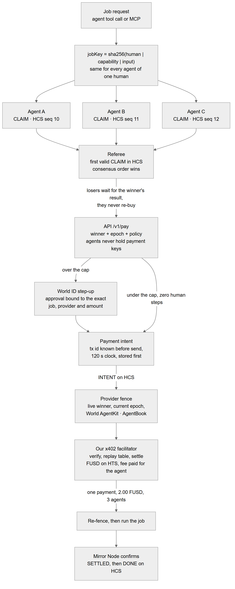
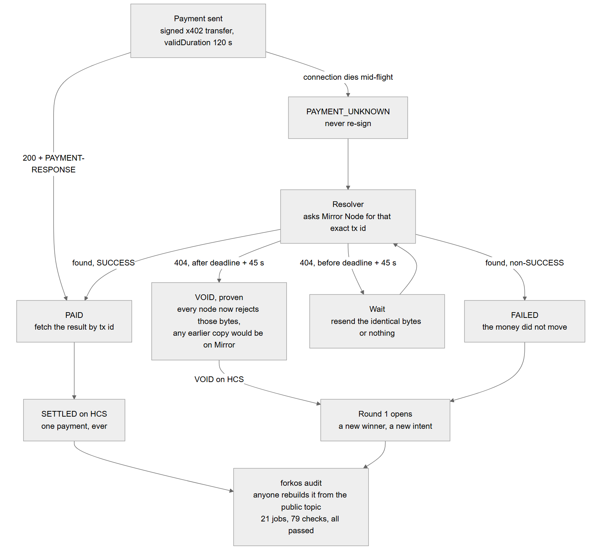

# Klero

**Agents fork. Money doesn't.** The exactly-once layer for AI agent payments.

Your agent sent a payment and the connection dropped. Did it pay? Klero gives every agent payment exactly two
possible endings — **PAID once, or provably VOID** — and lets anyone check which one happened without trusting us.

| | |
|---|---|
| Live demo | https://klero-eta.vercel.app |
| Video | TODO |
| API (Render) | https://klero-api.onrender.com/v1/health |
| HCS topic — referee + audit log | [`0.0.11332888`](https://hashscan.io/testnet/topic/0.0.11332888) |
| FUSD token (HTS, 6 dp) | [`0.0.11332887`](https://hashscan.io/testnet/token/0.0.11332887) |
| Facilitator fee payer | [`0.0.11332879`](https://hashscan.io/testnet/account/0.0.11332879) |
| A settled payment | [`0.0.11332879@1793950487.670000000`](https://hashscan.io/testnet/transaction/1793950501.210407857) — 2.00 FUSD, one payment for three agents |

**Status.** Everything marked ✅ below was verified by reading it back from Hedera (Mirror Node or HashScan) or
from World's issuer, not inferred from the code. Raw output is in [`docs/proof.md`](docs/proof.md) and
[`docs/world-debrief.md`](docs/world-debrief.md). What isn't built is listed under [Not in scope](#not-in-scope)
rather than left vague — including one claim this README used to make that turned out to be wrong, which is struck
through and corrected rather than deleted.

> Klero was built under the working name **ForkOS**, so some identifiers still carry it: the `pnpm forkos audit`
> CLI, the `@forkos/*` packages, the `forkos:` payment memo and error codes such as `forkos_replay_detected`.

---

## Why

Every agent wallet built so far stops *bad* payments: limits, allowlists, scam checks. None of them answer the
question that actually breaks agents in production — **the call to pay timed out, so did the money move?** Retry and
you may pay twice. Give up and the work never ships.

It gets worse with parallel agents. Your Claude agent and your Cursor agent work for the same person, and both can
decide to buy the same transcription. Nothing today notices that they are asking for the same thing.

Klero fixes both on Hedera, and keeps a person in charge of the agents through World.

## How one job runs



**The jobKey is the move.** Every agent of one human computes the same key for the same job —
`sha256(humanHash | capability | inputHash)` — even when they run in different apps. So three agents asking for the
same thing are recognisably asking for the *same* thing.

**HCS consensus order is the referee.** Each agent posts a CLAIM to the topic; the first valid claim by sequence
number wins. The losers never re-buy — they wait and receive the winner's result.

```text
discover services ────────────────────────────────▶ HCS SERVICE announcements (registered provider accounts)
jobKey = sha256(humanHash | capability | inputHash)   same for every agent of one human
submit CLAIM ─────────────────────────────────────▶ HCS seq 41    ← consensus order is the referee
   (another agent's claim lands at seq 42 and loses; it waits for the winner's result)
POST /v1/pay ──▶ check winner + epoch + policy
                 build intent (tx id known, 120 s clock), STORE IT, publish INTENT
                 provider: fence → verify → settle → re-fence → run
                 ◀── 200 {transcript, summary} + PAYMENT-RESPONSE
                 resolver: Mirror SUCCESS → publish SETTLED, then DONE
```

### The race, live on testnet ✅

Three agents linked to **one Orb-verified World ID**, each with its own Hedera account created from its own key.
Each agent's LLM picked its own provider; HCS picked the winner:

```text
[0x08cbf7] claimed round 1 via scribe-premium (HCS seq 12)
[0x4cb9d3] claimed round 1 via scribe-premium (HCS seq 10)
[0xa97079] claimed round 1 via scribe-b       (HCS seq 11)
[0x4cb9d3] WON (seq 10)
[0x4cb9d3] over cap → waiting for human approval (World ID)

Agent A  PAID_BY_OTHER
Agent B  PAID_BY_ME
Agent C  PAID_BY_OTHER
Mirror Node counter: payments = 1   (2.00 FUSD → scribe-premium 0.0.11332883)
```

The same meeting through three ordinary agents: **3 payments** (0.04 + 2.00 + 2.00 FUSD), counted from Mirror Node.

**Round 0 was abandoned safely, and that is part of the proof.** In the first run the winner also picked the 2.00
FUSD provider; its over-cap approval was never given, so no intent was created and no money moved. The referee
closed round 0 and opened round 1. An abandoned round that costs nothing is the property, not an accident.

## The death clock ✅



In Hedera's x402 `exact` scheme the **client** builds the transfer and sets its transaction id, so we know the id
*before sending*. The network rejects a duplicate id, and rejects a transaction whose `validStart + validDuration`
is past consensus time. Those two network rules make a lost payment answerable:

```text
deadline = validStart + 120 s

state(intent) =
  PAID     if Mirror Node has the tx id with result SUCCESS         (any time)
  FAILED   if Mirror Node has the tx id with a non-SUCCESS result   (money did not move)
  VOID     if now > deadline + 45 s AND Mirror Node returns 404      (can never execute again)
  UNKNOWN  otherwise                                                 (wait; never re-sign)
```

**VOID is a proof, not a timeout.** After the deadline every node rejects those bytes as expired, and any copy
submitted before it would already have reached consensus and be visible on Mirror Node. 45 s covers ingestion. So
a 404 after `deadline + 45 s` means the payment did not happen and *cannot* — not even if a malicious facilitator
still holds the signed bytes. FAILED closes the round the same way VOID does
([`resolver.ts`](backend/services/api/src/resolver.ts)), because the money did not move.

The intent is written to disk **before** it is sent. Retries resend the identical bytes and never re-sign. The
on-chain record of the settled payment shows `validDuration` **120 s** — the clock as the network recorded it.

### It cannot be paid twice — four independent layers ✅

| Layer | Refusal, observed live |
|---|---|
| Our facilitator's replay table | `settle: false forkos_replay_detected` — before any network call |
| Hedera itself, same bytes resubmitted directly | `DUPLICATE_TRANSACTION` — bypassing every facilitator we control |
| The clock | `forkos_intent_expired` (facilitator) **and** `TRANSACTION_EXPIRED` (network) |
| The proof | resolver returned `{ state: 'VOID', provedAtS: 1793930671 }` for an intent never sent |

The HBAR fee is paid by the **facilitator**, not the paying agent — agents need no HBAR.

## Verify us yourself ✅

No account and no setup beyond Node. This rebuilds every job from the public HCS topic and re-checks each claim of
payment against the ledger. It never touches our servers:

```bash
cd backend && pnpm install
npx tsx apps/cli/src/index.ts audit \
  --topic 0.0.11332888 \
  --operator 0.0.5899352 \
  --providers 0.0.11332881,0.0.11332882,0.0.11332883
```

Run on 2026-11-07 against the live topic:

```text
✓ 78f6336024b07205  A3 void proven       round 1 abandoned
✓ 78f6336024b07205  A4 winner paid       winner 0xa970793a3e3fd41decbfec0d7306ff1d759d8390

21 jobs, 79 checks — ALL PASSED
```

Five checks per job, from [`audit.ts`](backend/apps/cli/src/audit.ts): **A1** at most one SETTLED, **A2** the
settlement is real on the ledger with our memo, **A3** every abandoned round is provably void, **A4** the payment
came from the HCS winner, **A5** any refund is real.

## The six safeguards

| # | Safeguard | Enforced by | Where |
|---|---|---|---|
| S1 | Only a linked agent of *this* human can act for them | World ID device flow + HCS `LINK` | `services/api/src/world.ts`, `agents.ts` |
| S2 | One winner per job round, decided publicly | HCS consensus order | `packages/shared/src/referee.ts` |
| S3 | Agents never hold payment keys; the payer signs only for the HCS winner, within policy | API payer + row lock | `services/api/src/payer.ts` |
| S4 | A payment settles **at most once, ever**; unknown outcomes resolve to PAID or provably VOID | Hedera tx-id dedupe + expiry, Mirror Node, facilitator replay table | `packages/x402-hedera`, `services/facilitator` |
| S5 | A provider runs a job only for the live winner with current authority, after settlement | Fence reading HCS (winner + live link/epoch) | `services/provider/src/fence.ts` |
| S6 | Fire/replace and over-cap spending need a fresh human approval bound to that exact action | World ID step-up + action digest | `services/api/src/approvals.ts` |

## How it uses Hedera ✅

Zero `.sol` files. All ledger work goes through `@hiero-ledger/sdk`. Three native services, each load-bearing:

- **HCS** is the referee, the service directory and the audit log. Providers announce themselves there, agents claim
  there, and every intent, settlement, void, link and approval is published there.
- **HTS** carries the money: FUSD payments and refunds.
- **Mirror Node** is the judge. The resolver, the payment counter and `forkos audit` all read it.

**Our own x402 facilitator.** We use `x402ResourceServer` directly rather than the Fastify middleware, because that
middleware runs the route handler **before** settlement — fine for a free API, unsafe for a paid job. Our order is
fence → verify → record → settle → re-fence → run. The facilitator also refuses an intent with less than 2 s of
clock left, and caps the validity window at 120 s.

| Hedera x402 requirement | Where |
|---|---|
| x402-protected endpoint settling on Hedera testnet | `services/provider/src/routes.ts` → `services/facilitator` |
| An agent that **finds** the endpoint and pays end to end, no human | HCS service directory → `packages/agent-kit/src/agent.ts`; under-cap payments have zero human steps |
| Hedera tx id of a settled payment | table at the top + [`docs/proof.md`](docs/proof.md) |
| Spending controls + human approval above an amount | `services/api/src/policy.ts`, `approvals.ts` |
| HCS as a tamper-evident spending log | topic `0.0.11332888`, every event published |
| Multi-agent negotiation before payment | claim → HCS order → one winner (`referee.ts`) |
| Settling in an HTS token | FUSD `0.0.11332887` |

**We removed a data layer to trust less.** The service directory, claims and agent links first lived on a separate
store. HCS already gave us ordering and a public record, so they moved onto the topic and the other system went
away (`migrations/003_drop_arkiv.sql`).

Three things that only surfaced against live testnet, all fixed and written up in
[`backend-deviations.md`](docs/planning/backend-deviations.md):

- **Mirror Node rejects `sequencenumber=gt:0`.** It is the natural way to say "from the start", but HCS sequence
  numbers begin at 1, so testnet answers HTTP 400. Our own spec made that call in three places.
- **Following `links.next` on a long topic walked for 4+ minutes.** The reader is now bounded, resumable and
  gap-checked. A gap-free prefix in order is never wrong, only incomplete — the referee can decide a winner from
  it — while a *gap* could produce a wrong winner, so gaps throw.
- **A stalled Mirror request crashed the winning agent, twice.** With no deadline, undici waited its 300 s
  `headersTimeout`; both crashes came *after* the payment had completed. Every request now has a 15 s deadline and
  up to 3 attempts for network errors, timeouts and 5xx. **A 404 is never retried** — a 404 is an answer, and the
  VOID proof rests on it.

## How it uses World ✅

**World ID Agent Pass** protects three actions, all validated in the backend
([`world.ts`](backend/services/api/src/world.ts)): **link an agent**, **fire/replace an agent**, and **spend above
the autonomous cap**. Flow: Device Authorization Grant (RFC 8628) against production `auth.world.org`.

- Every ID token is verified against the issuer's JWKS for `iss`, `aud`, `exp`, and an `auth_time` that is present,
  fresh within `WORLD_FRESH_SECONDS`, and no earlier than the attempt started.
- Step-ups pin the owner's `sub` and are bound to a digest of the exact action. An over-cap approval covers job,
  round, provider, payTo, amount and asset, and is consumed in the same database transaction that writes the payment
  intent — so it cannot be replayed onto a different payment or used twice.
- One human's agents share one World ID subject, which is what gives agents from different apps one budget and one
  dedupe scope. Cross-platform exactly-once is a direct consequence of Agent Pass.
- Device codes are stored AES-256-GCM encrypted and never leave the backend.

**Side effects happen only after approval.** Linking creates a Hedera account and publishes to HCS. In the observed
denied path (`access_denied`), the database read `humans 0 | agents 0 | agent_tokens 0` afterwards and the operator
balance was unchanged — nothing partial was left behind. Approved, expired, denied and replayed-approval paths are
all in [`docs/world-debrief.md`](docs/world-debrief.md).

**World AgentKit on the x402 path.** The provider's `402` carries the standard `extensions.agentkit` challenge. The
winning agent signs it (SIWE on World Chain) with its own key — the same key as its Hedera account — and the API
relays the header without ever holding agent keys. Before anything settles, the provider fence checks the signature
is fresh, single-use, issued by that provider and made by the HCS winner, then looks the wallet up in World
**AgentBook**. `PROVIDER_AGENTKIT=off | verify | require` (`require` serves only agents registered to a human).
AgentKit is deliberately **not** registered as an x402 hook, so it can never change how a Hedera payment is verified
or settled — it can only refuse an agent. Code: `services/provider/src/agentkit.ts`,
`packages/agent-kit/src/agentkit.ts`.

Two traps worth naming, because they cost us hours:

- **The approval page offered only "Continue with a passkey".** After World App reported the proofs shared, users
  without a passkey sat in `authorization_pending` until the 20-minute code expired. The fix — send
  `acr_values=https://world.org/oidc/acr/orb-face` on the device request — lives in the step-up guide, not the
  device-flow guide (`WORLD_ACR_VALUES`).
- **`access_denied` looks identical to a user pressing cancel.** With accepted accounts left on Orb-only, every
  non-matching identity fails the same way. We accept "Any account".

## Also shipped

- **A dashboard** ([klero-eta.vercel.app](https://klero-eta.vercel.app)) — link agents, watch races live, approve
  over-cap payments, and a per-payment proof page at `/proof/[intentId]`.
- **An MCP server** (`backend/apps/mcp`) so an agent in Claude Desktop or Cursor calls Klero directly:
  `forkos_whoami`, `forkos_services`, `forkos_buy_transcription`.
- **Fire an agent and it is dead immediately.** Its epoch bumps, its tokens die, and providers refuse it through the
  fence. Linking it back takes another World approval and returns it as a new epoch.
- **The demo service is real work**: meeting transcription (OpenAI Whisper) plus a short summary, with a
  deterministic `outputHash` over `{transcript, summary}`.

## Deployment

| Part | Where |
|---|---|
| Frontend | Vercel — https://klero-eta.vercel.app |
| API | Render — https://klero-api.onrender.com |
| Facilitator | Render — https://klero-facilitator.onrender.com |
| Providers | Render — `klero-scribe-a`, `klero-scribe-b`, `klero-scribe-premium` `.onrender.com` |
| Database | Render Postgres (Singapore) |

The public deployment runs with **the chaos controls off** (`PROVIDER_ALLOW_CHAOS=false`, no demo key in the
frontend), because a key built into public JavaScript is a key everyone has. Each service gets only the environment
variables its own `loadEnv` schema reads — the facilitator never sees the operator key, World or OpenAI credentials.

It runs on free tiers, which is a real constraint rather than a footnote: services sleep after 15 minutes idle and
take about a minute to wake, so the first payment after a pause can time out. Open the health URLs before a demo.

## Run it

```bash
cd backend
pnpm install
cp .env.example .env            # fill OPERATOR_*, WORLD_*, OPENAI_API_KEY
pnpm keys:new                   # generates the wallet keys and secrets
pnpm db:up && pnpm db:migrate
pnpm bootstrap:hedera           # creates accounts, the FUSD token and the HCS topic

pnpm dev:facilitator            # :4020
pnpm dev:scribe-a               # :4031   (also -b :4032, -premium :4033)
pnpm dev:api                    # :4040

pnpm agent:link "Agent A"       # approve on your phone (World ID)
pnpm baseline                   # 3 independent agents -> 3 payments
pnpm agents 3                   # 3 Klero agents       -> 1 payment
```

**Windows, one command** (after setup; Docker Desktop running) — starts Postgres + migrations, the facilitator, the
three providers and the API in the background, waits for every health check and warns if a baseline wallet is low:

```powershell
powershell -ExecutionPolicy Bypass -File backend\scripts\win\dev-up.ps1     # stop: backend\scripts\win\dev-down.ps1
```

Also in `backend\scripts\win\`: `use-meeting.ps1 -N <n>` (fresh demo meeting) and `topup-baseline.ps1`. The full
demo walkthrough is [`docs/demo-video.md`](docs/demo-video.md).

```bash
pnpm test          # 135 tests in 15 files
pnpm typecheck     # the whole workspace
```

**135 tests; 122 run with no database. The other 13 need Postgres** (`pnpm db:up` first) — the schema constraints
behind run-at-most-once, and the facilitator replay table including two concurrent settles for one tx id. Without a
database they fail with `ECONNREFUSED 127.0.0.1:5442`, which is a missing dependency rather than a passing suite,
and is said so here rather than counted as green.

## Not in scope

Named explicitly, because a vague scope claim is worse than a small one:

- **Testnet only.** Nothing here has handled real money.
- **Budget keys are custodial.** The API holds each human's budget-account key, encrypted with AES-256-GCM. Hedera
  Agent Accounts would remove this; we did not have time.
- ~~**World identities are test identities.** Mocked proofs, as the Mumbai track specifies.~~ That was wrong. The
  approvals in [`docs/proof.md`](docs/proof.md) and [`docs/world-debrief.md`](docs/world-debrief.md) are a real
  Orb-verified World ID on production `auth.world.org` (`acr` `orb-face`, `amr` `["pop","face","user"]`). The app
  accepts "Any account", so test identities also work — but the recorded runs are not mocked.
- **A refunded job is final.** There is no automatic retry with another provider.
- **The provider set is ours.** Third-party sellers work for *payment* today, but only a fenced provider gets the
  execution guarantee (S5); an unfenced seller can still be asked to run a job by a stale agent.
- **One Postgres for three services.** Fine for a hackathon, not a deployment topology.
- **The live deployment's World + payment flow has not been run end to end.** Every service passes its health
  check and the frontend reaches the API, but the recorded race and approvals ran on a local stack. The public
  instance is the same code with the chaos controls off.

## Attribution

Built at **ETHGlobal Mumbai 2026**. Event work begins at `03098d7` (2026-11-06 01:52).

**AI tools:** built with AI assistance (Claude). The planning documents written before the hack are committed in
[`docs/planning/`](docs/planning/) as ETHGlobal requires for spec-driven development; all project code was written
during the hackathon from those specs. AI assistance covered implementation from the spec, test authoring and
documentation. The architecture, the death-clock mechanism, the safeguard model and every sponsor-integration
decision were authored by the team. Deviations found while building — including two real bugs in the spec, caught by
running against live testnet — are logged in
[`docs/planning/backend-deviations.md`](docs/planning/backend-deviations.md).

**Open source used:** Hiero SDK (`@hiero-ledger/sdk`), x402 (`@x402/core`, `@x402/hedera`), World AgentKit, Fastify,
Next.js, viem, [`jose`](https://github.com/panva/jose) (panva's JWT library, used to verify World ID tokens), Zod,
postgres.js, Vitest.

## Team

- sylesh7 · [github.com/sylesh7](https://github.com/sylesh7)
- Jose Regish · [github.com/hackerjose25](https://github.com/hackerjose25)

## Licence

MIT — see [`backend/LICENSE`](backend/LICENSE).
