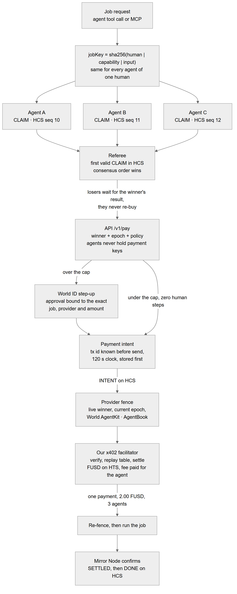
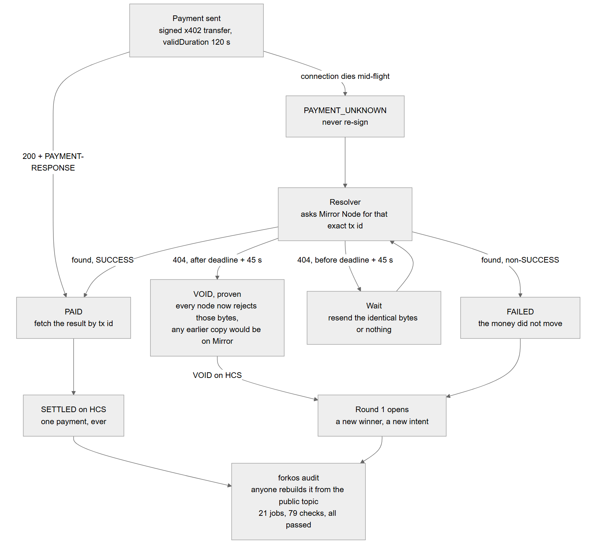

# Project Description

Klero makes sure an AI agent's payment happens exactly once: it either settles one time, or it is proven that it never happened and never can.

Every agent wallet built so far stops *bad* payments, using limits, allowlists and scam checks. None of them answer the question that actually breaks agents: **your agent sent a payment and the connection dropped, so did it pay?** Retry and you might pay twice. Give up and the work never ships. It gets worse with parallel agents. Your Claude agent and your Cursor agent can both decide to buy the same transcription, and today nothing stops them.

Klero gives every agent payment exactly two possible endings: **PAID once, or provably VOID.** There is no third state and no guessing.

## How one job runs



The important move is the **jobKey**. Every agent that works for the same human computes the same key for the same job, `sha256(human | capability | input)`, even if they run in different apps. So three agents asking for the same thing are recognisably asking for the *same* thing.

Each agent posts a CLAIM to the **Hedera Consensus Service**, and HCS consensus order is the referee: the first valid claim wins. The losers don't buy again. They wait and receive the winner's result.

A real run on testnet, three agents linked to one Orb-verified World ID:

```
3 agents claim → HCS seq 10, 11, 12 → seq 10 wins → over the 1.00 FUSD cap → World ID approval
→ 2.00 FUSD paid once → Agent A: PAID_BY_OTHER · Agent B: PAID_BY_ME · Agent C: PAID_BY_OTHER
Mirror Node counter: payments = 1
```

The same meeting through three ordinary agents: **3 payments** (0.04 + 2.00 + 2.00 FUSD), counted from Mirror Node.

## The death clock



In Hedera's x402 `exact` scheme the client builds the transfer, so we choose the transaction id **before sending** and give it a validity window of 120 seconds. Hedera rejects a duplicate transaction id, and it rejects a transaction whose window has passed. Those two network rules are what make a lost payment answerable:

```
PAID     Mirror Node has the tx id with SUCCESS
FAILED   Mirror Node has the tx id with another result (the money did not move)
VOID     now > deadline + 45 s AND Mirror Node returns 404
UNKNOWN  anything else: wait, resend the same bytes, never re-sign
```

VOID is a proof, not a timeout. After the deadline every node rejects those bytes as expired, and any copy sent before it would already be on Mirror Node. So a 404 after `deadline + 45 s` means the payment didn't happen and *can't*, not even if someone still holds the signed bytes. The intent is written to disk before it is sent, and retries only ever resend the identical bytes.

## A person stays in charge

Agents are backed by a real human through **World**:

- **World ID Agent Pass** protects three actions, all checked in our backend: linking an agent, firing or replacing one, and spending above the autonomous cap. Each approval is bound to a digest of the exact action (job, round, provider, amount), so it can't be replayed onto a different payment. One person's agents share one World ID subject, which is what gives them one budget and one dedupe scope across apps.
- **World AgentKit** sits on the payment path. The provider's 402 carries the AgentKit challenge, the winning agent signs it with its own key, and before any money moves the provider checks the signature is fresh, single-use, made by the HCS winner, and that the wallet belongs to a human in **AgentBook**.

Under the cap, an agent finds the service on HCS and pays end to end with zero human steps. Above it, the payment stops and waits for a phone approval, and then *that same payment* settles.

## You don't have to trust us

One command rebuilds every job from the public HCS topic and checks each claim of payment against the ledger. It never touches our servers:

```
pnpm forkos audit --topic 0.0.11332888 --operator 0.0.5899352 --providers 0.0.11332881,0.0.11332882,0.0.11332883
21 jobs, 79 checks — ALL PASSED
```

It checks five things per job: at most one settled payment, the settlement is real on the ledger, every abandoned round is provably void, the payment came from the winner, and any refund is real.

## Also shipped

- **Our own x402 facilitator** on Hedera testnet, settling payments in an HTS token (FUSD `0.0.11332887`). The facilitator pays the HBAR fee, so agents don't need HBAR.
- **Four layers against double payment**, each shown live: our facilitator's replay table (`forkos_replay_detected`), Hedera itself (`DUPLICATE_TRANSACTION`), the clock (`forkos_intent_expired` and `TRANSACTION_EXPIRED`), and the VOID proof.
- **A provider fence**: a provider runs a job only for the live winner with current authority, and only after settlement.
- **Fire an agent and it is dead immediately.** Its epoch bumps, its tokens stop working, and providers refuse it through the fence. Linking it back takes a new World approval and gives it a new epoch.
- **An MCP server**, so an agent in Claude Desktop or Cursor can call Klero directly (`forkos_whoami`, `forkos_services`, `forkos_buy_transcription`).
- **A dashboard** for linking agents, watching races live, approving over-cap payments and reading a per-payment proof page.

## What we deliberately didn't build

- **Testnet only.** Nothing here has handled real money.
- **Budget keys are custodial.** The API holds each human's budget-account key, encrypted with AES-256-GCM. Hedera Agent Accounts would remove this; we ran out of time.
- **World identities are test identities**, as the Mumbai track specifies.
- **A refunded job is final.** There's no automatic retry with another provider.
- **The provider set is ours.** Third-party sellers can be *paid* today, but only a fenced provider gets the execution guarantee.

---

# How it's Made

**Stack.** A TypeScript pnpm monorepo. The backend is three Fastify 5 services (API, facilitator, providers) on Postgres 16; the frontend is Next.js 16 with React 19 and TanStack Query. Ledger access is `@hiero-ledger/sdk` end to end, with **zero Solidity files**. Payments use `@x402/core` and `@x402/hedera` 2.30.0. World ID tokens are verified with `jose`, AgentKit signatures with `viem`, and every boundary is validated with Zod. The demo service is meeting transcription: OpenAI Whisper plus a short summary. It's deployed on Vercel (frontend) and Render (backend), and the test suite has about 135 tests across 15 files.

**Hedera is the whole trust layer, three native services deep.**

- **HCS** is the referee, the service directory and the audit log. Providers announce themselves there, agents claim jobs there, and every intent, settlement, void, link and approval is published there. We first stored the directory and agent links on a separate data layer, then removed it: HCS already gave us ordering and a public record, so one less system to trust.
- **HTS** carries the money: FUSD payments and refunds.
- **Mirror Node** is the judge. The resolver, the payment counter and the public audit all read it.

**Our own facilitator.** We use `x402ResourceServer` directly instead of the Fastify middleware, because the middleware runs the route handler *before* settlement. That's fine for a free API, but unsafe for a paid job. Our order is fence → verify → record → settle → re-fence → run. The facilitator also refuses any intent with less than 2 seconds of its clock left, and caps the validity window at 120 seconds.

**World ID** uses the Device Authorization Grant against `auth.world.org`. Every ID token is checked against the issuer's JWKS for `iss`, `aud`, `exp`, and an `auth_time` that is fresh and no earlier than the attempt started. Device codes are stored encrypted and never leave the backend. An over-cap approval is consumed in the same database transaction that writes the payment intent, so it can't be used twice. **AgentKit** is deliberately *not* registered as an x402 hook, so it can never change how a Hedera payment is verified or settled. It can only refuse an agent.

## The hacky parts worth naming

- **Mirror Node rejects `sequencenumber=gt:0`.** It's the natural way to say "read the topic from the start", but HCS sequence numbers begin at 1, so it returns HTTP 400. Three places in our own spec made this call, and we only found it by running against live testnet.
- **Reading a long topic could take minutes.** Following `links.next` in a loop walked for more than 4 minutes on a busy public topic. We rebuilt the reader to be bounded and resumable, and to throw on gaps. A gap-free prefix in order is never wrong, only incomplete, so a winner can be decided without reading everything, while a gap could produce a wrong winner.
- **A stalled Mirror request crashed our winning agent, twice.** With no timeout, a hung connection waited 300 seconds and the agent died, both times *after* the payment had already gone through. Now every request has a 15-second deadline and up to 3 retries for network errors and 5xx. A 404 is never retried, because a 404 is an answer and the VOID proof rests on it.
- **The World approval page got users stuck.** After the World App said proofs were shared, the browser page only offered "Continue with a passkey", and users without one sat in `authorization_pending` until the code expired. The fix, sending `acr_values=orb-face` on the device request, was in the step-up guide rather than the device-flow guide.
- **"Access denied" looked identical to "cancel".** With accepted accounts left on Orb-only, every test identity was refused in a way that looked exactly like a user pressing cancel. We switched to "Any account", as the track's mocked proofs require.
- **An abandoned round must cost nothing.** In one live run the winner picked a 2.00 FUSD provider, its over-cap approval was never given, and the round was abandoned. No intent was created, no money moved, and the audit shows that round as provably void before the next round paid once.

Every number above comes from a live testnet run, and `docs/proof.md` in the repo has the raw output.
